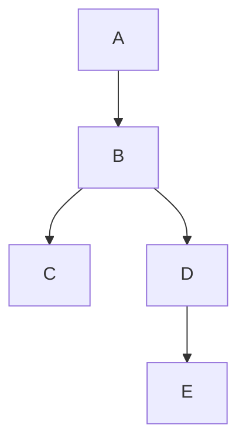

# ChatGPT Export Reader

Turns ChatGPT data exports into Markdown documents for easy browsing.

Objective :

- Stream the conversations.json file, convert every chat into a readable markdown-based representation
- Problem : chats are trees. Map to file system trees? Problem, some tree branches are tiny, others are huge. Instead, minimize switch points. Make a file for the longest brnach, then brnach off into another file, etc with relative links to not get lost.

For instance :



Result:

Chat Title.md

```md
# title

id
create_time
update_time

user_editable_context

## 1. Role

Timestamp

$$
A
$$

## 2. Role@Timestamp

### Body

C

### Branches

## C
```

## Step 0

Extract one chat object.

Infer facts schema structure in a strategy object (in case current schema changed today, map data requests -> how to get it in the schema)

- metadata in keys
- messages stored in the `mapping` key, keyed by UUID
- special `client-created-root` key contains the first message
- there is bidirectional parent/children tree, but we can just walk `children`
- message object contains message data in a `message` key
- role in `message.author.role`
- create_time in `message.create_time`, update_time also known but likely not relevant and oftne null
- `message.metadata.is_visually_hidden_from_conversation`
- content in `message.content.parts` array (only support `message.content.content_type` = `"text"` for v0). Mutliple elements not observed. Error if not singleton. Concatenate content. If empty string, skip the message.
- there is one message where `message.content.content_type` = `"user_editable_context"`, with a `user_instriction` keys containing the custom instructions block. (duplicated in `message.metadata.user_context_message_data` but we don't need that here)
- there is also `weight` which seems to be always 0 or 1. Include it in the result, in case we get something interesting

Algorithm:

- read chat object
- read root message
- when finding user_editable_context (custom prompt), add it to the beginning

1. parse chat object with zod
2. convert to IR message
3. export to markdown files

Difficulty converting schema msg mapping to my recursive message format.
since some mesage contain userInstructions, other contain text
an iterative non recurisve approach.

Basically
- Input: flat array of Message[]. content may be null (bubble children up), user_editable_text (set userInstructions)
- Output: { message: my.Message, userInstructions: string | null,  }

## Step 1

- streaming JSON array parse (multiple chats)
- increment Markdown headings to match output document hierarcy

converting a chat tree to markdown files:

what do we do when we hit multiple children?
multiple files with continuation point

Title.md

```md
## 1. Assistant

Message 1

Branches:

[Child message 2](./Title.Child message 2.md)
[Child message 3](./Title.Child message 3.md)

## 2. User

Child message 1

```

Title.Child message 2.md

```md
# Title > Child message 2..

[Source](<./Title.md#1. assistant>)

Message 1

## 1.1 Assistant

## 1.2
```

Create branch-off file only if child message also has children

algorithm:

- walk tree of messages
- keep longest branch in current file
- create new files for other branches

how do we return the documents?
we return
Document = { title: string, messages: Message[], branches: Document[] }
